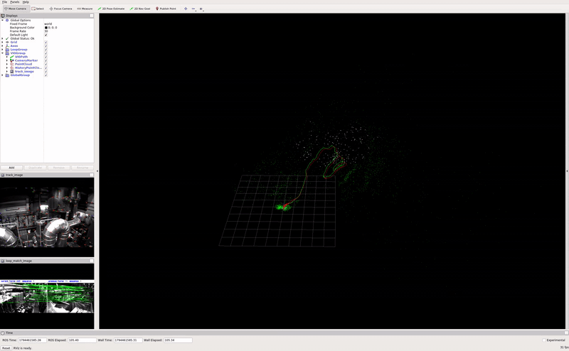
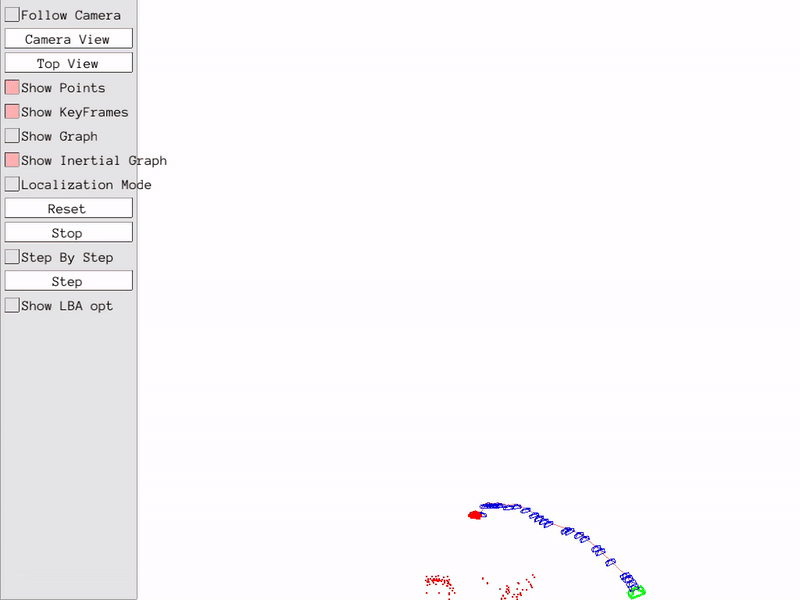
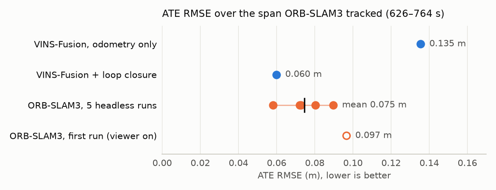
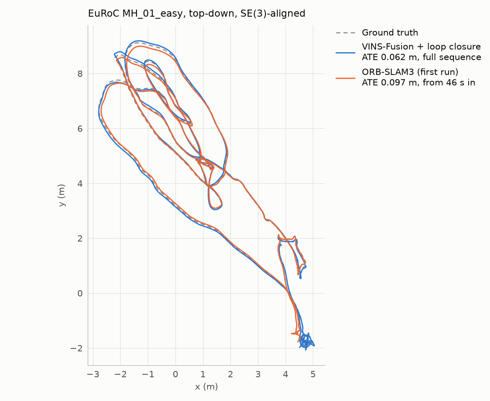
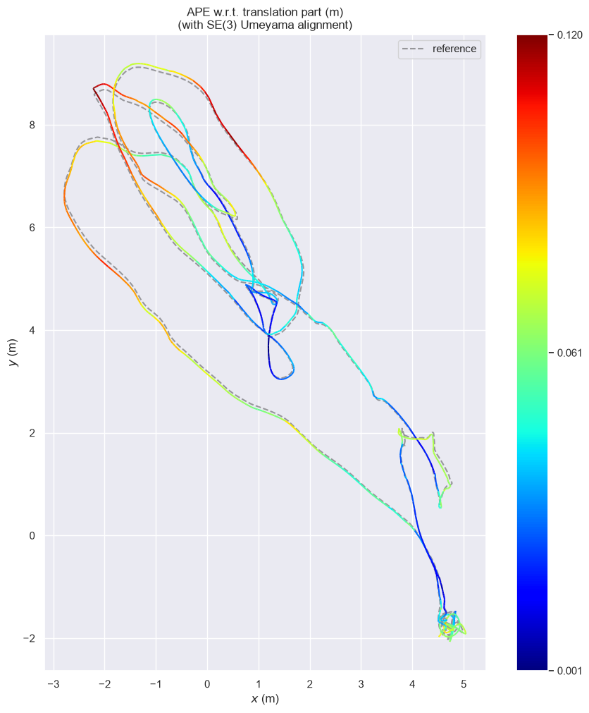
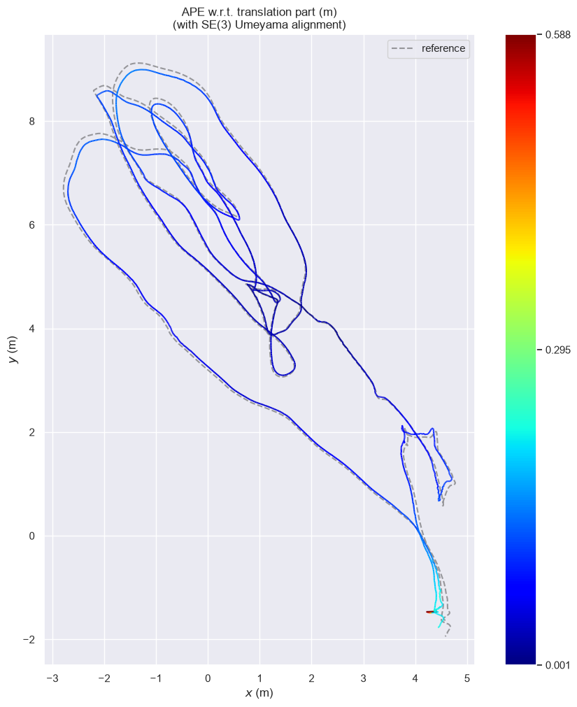
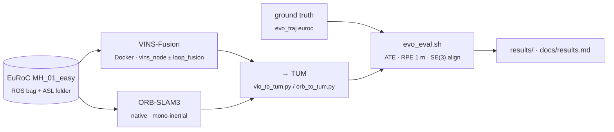

<div align="center">

# VINS-Fusion vs ORB-SLAM3: Visual-Inertial SLAM on EuRoC

**A reproducible, like-for-like comparison of two widely used monocular visual-inertial systems on EuRoC
MH_01_easy, covering loop closure on vs off, run-to-run repeatability, and every workaround needed to build them on Ubuntu 22.04.**

Built with [VINS-Fusion](https://github.com/HKUST-Aerial-Robotics/VINS-Fusion) · [ORB-SLAM3](https://github.com/UZ-SLAMLab/ORB_SLAM3) · [evo](https://github.com/MichaelGrupp/evo) · Docker · ROS Kinetic

<table>
<tr>
<td></td>
<td></td>
</tr>
<tr>
<td align="center"><sub>VINS-Fusion + loop closure (RViz). Green: odometry, red: loop-closed pose graph</sub></td>
<td align="center"><sub>ORB-SLAM3 mono-inertial (Pangolin viewer)</sub></td>
</tr>
</table>
<sub>Both clips at 2× speed. They come from separate visual-only runs; every number below is from headless runs.</sub>

</div>

---

## Highlights

- **Two systems, one evaluation recipe.** Both are run on the same sequence and scored with the same evo settings
  (SE(3) Umeyama, ATE + 1 m RPE) and the same ground-truth file, from [one script](evaluation/evo_eval.sh).
- **Loop closure cuts VINS-Fusion's ATE by 66%** (0.181 → 0.062 m), while local drift stays the same (1 m RPE 0.034 → 0.033 m).
  The odometry is byte-identical with and without `loop_fusion`, so loop closure is the only thing that differs.
- **Fair comparison window.** ORB-SLAM3 resets its map until the IMU initializes and loses the first ~46 s, so the
  VINS trajectories are also scored on just the span ORB-SLAM3 tracked.
- **Repeatability, not one lucky run.** ORB-SLAM3 is multi-threaded and not deterministic. Five headless runs give
  **0.075 ± 0.012 m** ATE, with 12–36 map resets per run.
- **Builds on a modern host, with no sudo.** VINS-Fusion (ROS Kinetic) runs in Docker, with RViz inside the container.
  ORB-SLAM3 + Pangolin v0.9.6 are built natively at C++17 with a [two-line patch](orbslam3/patches/orbslam3_cxx17.patch).
  Every problem I hit is documented with its fix.
- **Checked for reproducibility.** Re-running every evaluation from the committed trajectories reproduces all 24
  evo outputs line for line, and the regenerated ground truth is byte-identical.

## Results at a glance

On the 138 s window both systems tracked (626–764 s, after ORB-SLAM3's map initializes):

| | ATE RMSE (m) | RPE 1 m trans (m) | RPE 1 m rot (deg) | Tracks take-off? |
|---|---|---|---|---|
| VINS-Fusion, odometry only | 0.135 | 0.037 | 0.249 | yes |
| **VINS-Fusion + loop closure** | **0.060** | 0.035 | 0.237 | yes |
| **ORB-SLAM3** (mean of 5 runs) | **0.075** ± 0.012 | 0.027–0.047* | 0.115–0.150 | no (first ~46 s lost) |

<sub>*Runs 1–3 and 5. Run 4 initialized 40 s early, and its first seconds inflate its full-span RPE to 0.22 m (details in [docs/results.md](docs/results.md#3-orb-slam3-repeatability-5-headless-runs)).</sub>

<picture>
  <source media="(prefers-color-scheme: dark)" srcset="assets/ate_runs_dark.png">
  
</picture>

**Takeaway:** compared with odometry-only VINS, ORB-SLAM3 is clearly more accurate. With loop closure on for both,
they are effectively tied on this easy sequence: VINS's single run (0.060 m) sits next to ORB-SLAM3's best (0.058 m).
ORB-SLAM3 has about half the rotational drift. VINS-Fusion initializes immediately and covers the whole flight.

---

## Trajectories

<picture>
  <source media="(prefers-color-scheme: dark)" srcset="assets/trajectories_dark.png">
  
</picture>

<details>
<summary><b>Where the error is: trajectories coloured by ATE</b></summary>
<br>

| VINS-Fusion + loop closure | ORB-SLAM3 (first run) |
|---|---|
|  |  |

ORB-SLAM3's largest error (0.59 m) is a single spike in the first frames after IMU initialization. Its median is 0.078 m.
</details>

## ORB-SLAM3 repeatability

| Run | Map resets | Tracked from (s) | ATE RMSE (m) |
|---|---|---|---|
| 1 | 19 | 626.1 | 0.080 |
| 2 | 33 | 625.3 | 0.058 |
| 3 | 36 | 626.2 | 0.072 |
| 4 | 12 | 586.0 | 0.090 |
| 5 | 15 | 626.2 | 0.073 |
| **mean ± std** | **23** | | **0.075 ± 0.012** |

- **Run 4** started its map 40 s earlier than the others. Its first ~14 s, before the IMU settled, reach 1.29 m of error. From 626 s on it scores 0.069 m.
- **The first run** (viewer on, run alone) scored 0.097 m.
- **A later unscored smoke-test run** scored 0.027 m. The real spread is wider than five runs show; see [docs/results.md](docs/results.md#unscored-extra-runs).

---

## How it works



**Dataset.** [EuRoC MAV](https://doi.org/10.3929/ethz-b-000690084) MH_01_easy: a ~180 s drone flight in a machine hall,
with a 20 Hz global-shutter camera (cam0), a 200 Hz IMU, and Leica laser-tracker ground truth. VINS-Fusion reads the ROS bag. ORB-SLAM3 reads the ASL folder.

**VINS-Fusion** (`be55a93`) runs mono + IMU with the upstream EuRoC config. It is an optimization-based sliding-window estimator.
`loop_fusion` adds DBoW loop detection and 4-DoF (x, y, z, yaw) pose-graph optimization. It runs in the upstream Docker
image (ROS Kinetic), with RViz added in a thin layer, so the host needs no ROS 1. [Setup →](docs/setup_vins_fusion.md)

**ORB-SLAM3** (`4452a3c`) runs the EuRoC mono-inertial example with default settings, including its built-in loop closing and
map merging. It is built natively against Pangolin v0.9.6 at C++17. For scored runs, a headless copy of the example is
built with the original CMake flags, with only the viewer flag changed. [Setup →](docs/setup_orbslam3.md)

**Evaluation.** [`evaluation/evo_eval.sh`](evaluation/evo_eval.sh) is the only evo recipe in the repo:
`evo_ape -a -r trans_part`, plus `evo_rpe -a --delta 1 --delta_unit m` with `trans_part` and `angle_deg`.
The ground truth (IMU/body frame) is converted with `evo_traj euroc`. [Full results →](docs/results.md)

## Repository layout

```
.
├── env.sh                     # all paths (data, third_party, venv, image); override via environment
├── vins_fusion/
│   ├── build_docker.sh        # clone VINS-Fusion @ be55a93, build ros:vins-fusion + RViz layer
│   ├── docker/Dockerfile.rviz
│   ├── config/                # upstream EuRoC mono+IMU config, output paths made absolute
│   ├── run.sh                 # LOOP=0|1, RVIZ=0|1: roscore + vins_node (+ loop_fusion) + rosbag play
│   ├── evaluate.sh            # vio.csv / vio_loop.csv -> TUM -> evo
│   └── vio_to_tum.py
├── orbslam3/
│   ├── build.sh               # Pangolin v0.9.6 + ORB-SLAM3 @ 4452a3c (C++17), clean env
│   ├── patches/orbslam3_cxx17.patch
│   ├── headless/              # viewer-off copy of the EuRoC example + build with the original CMake flags
│   ├── run.sh                 # VIEWER=0|1
│   ├── run_repeats.sh         # N runs, P in parallel, evaluated + summarized
│   ├── evaluate.sh
│   └── orb_to_tum.py
├── evaluation/
│   ├── evo_eval.sh            # the evo recipe behind every number
│   ├── gt_to_tum.sh           # EuRoC ground truth -> TUM
│   ├── common_window.sh       # crop VINS to ORB-SLAM3's span and re-evaluate
│   ├── traj_plot.sh
│   └── summarize_repeats.py
├── results/                   # estimated trajectories (TUM), evo outputs (.txt/.zip), plots, run logs
│   ├── vins_fusion_odom/  vins_fusion_loop/  orbslam3/  orbslam3_repeats/  common_window/  smoke_runs/
├── tools/
│   ├── get_data.sh            # extract MH_01_easy from machine_hall.zip
│   ├── record_media.sh        # visual-only runs + screen capture (ffmpeg x11grab)
│   ├── record_window.sh  make_gif.sh
│   └── make_readme_media.py   # rebuilds the README figures from results/
├── docs/                      # setup notes, full results, media notes
└── assets/                    # README figures, GIFs and MP4s
```
`data/`, `third_party/` (upstream checkouts and builds) and `outputs/` (raw runs) are gitignored.

## Reproduce

**Setup.** Ubuntu 22.04, Docker (no sudo needed if your user is in the `docker` group), X11 for the viewers, Python 3 for evo.
```bash
git clone https://github.com/ShreyasKhobragade/vio-slam-benchmark.git && cd vio-slam-benchmark
python3 -m venv .venv && .venv/bin/pip install -r requirements.txt
tools/get_data.sh ~/Downloads/machine_hall.zip   # download in a browser first; see docs/setup_vins_fusion.md
vins_fusion/build_docker.sh                      # ~4.4 GB of images
orbslam3/build.sh                                # Pangolin + ORB-SLAM3 + headless example
```

**Run and evaluate**
```bash
LOOP=0 vins_fusion/run.sh && vins_fusion/evaluate.sh outputs/vins_odom results/vins_fusion_odom
LOOP=1 vins_fusion/run.sh && vins_fusion/evaluate.sh outputs/vins_loop results/vins_fusion_loop
orbslam3/run.sh           && orbslam3/evaluate.sh outputs/orbslam3 results/orbslam3 --plots
N=5 P=3 orbslam3/run_repeats.sh
evaluation/common_window.sh
.venv/bin/python -I tools/make_readme_media.py
```
Each run plays the sequence in real time, about 3 minutes.

**Re-score without rerunning anything:** `evaluation/evo_eval.sh results/orbslam3/orbslam3_mh01_est.tum /tmp/check` (any committed `*_est.tum` works).

## Next steps

- **Harder sequences:** MH_02–05 and V1/V2 (fast motion, low texture), where VINS's immediate initialization and ORB-SLAM3's relocalization should matter more.
- **Stereo-inertial** for both systems. This removes ORB-SLAM3's long monocular initialization.
- **More ORB-SLAM3 runs** (20+) to pin down its distribution. One extra run already scored 0.027 m.
- **Timing:** per-frame tracking latency and CPU usage under the same real-time playback.

## Acknowledgements

[VINS-Fusion](https://github.com/HKUST-Aerial-Robotics/VINS-Fusion) (HKUST Aerial Robotics Group),
[ORB-SLAM3](https://github.com/UZ-SLAMLab/ORB_SLAM3) (University of Zaragoza),
[Pangolin](https://github.com/stevenlovegrove/Pangolin), [evo](https://github.com/MichaelGrupp/evo) for trajectory evaluation, and the
[EuRoC MAV dataset](https://doi.org/10.3929/ethz-b-000690084) (ETH Zurich, ASL). VINS-Fusion and ORB-SLAM3 are GPLv3.
This repo contains only scripts, configs, a patch, and a modified copy of one ORB-SLAM3 example file.
