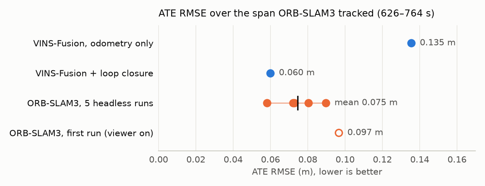

# Results: VINS-Fusion vs ORB-SLAM3 on EuRoC MH_01_easy (monocular + IMU)

## Method
Every number comes from [`evaluation/evo_eval.sh`](../evaluation/evo_eval.sh) (evo 1.38.1):
- Alignment: SE(3) Umeyama (`-a`), no scale correction. Mono+IMU is metric.
- **ATE:** `evo_ape -r trans_part`
- **RPE:** `evo_rpe --delta 1 --delta_unit m`, with `-r trans_part` and with `-r angle_deg`
- Ground truth: `mav0/state_groundtruth_estimate0/data.csv` (IMU/body frame), converted with `evo_traj euroc --save_as_tum`.
- Pose association: max 0.01 s time difference.

All scored runs are headless with nothing else recording the screen. Times are seconds after 1403636000.
Every evo output is in [`results/`](../results).

## 1. Full runs

| Run | Span covered | Poses matched | ATE RMSE (m) | ATE mean / median / max (m) | RPE 1 m trans (m) | RPE 1 m rot (deg) |
|---|---|---|---|---|---|---|
| VINS-Fusion, odometry only | 580.8 – 763.8 s (all) | 1819 | 0.181 | 0.155 / 0.134 / 0.416 | 0.034 | 1.268 |
| **VINS-Fusion + loop_fusion** | 580.8 – 763.4 s (all) | 1086 | **0.062** | 0.056 / 0.055 / 0.120 | 0.033 | 0.491 |
| ORB-SLAM3, first run (viewer on) | 626.2 – 763.8 s | 2732 | 0.097 | 0.081 / 0.078 / 0.588 | 0.030 | 0.121 |
| ORB-SLAM3, 5 headless runs (mean) | ~626 – 763.8 s | – | **0.075** (0.058–0.090) | – | – | – |

- **Loop closure cuts VINS ATE by 66%.** Local drift (1 m RPE translation) is unchanged.
  The odometry (`vio.csv`) from the loop run is byte-identical to the odometry-only run, so loop closure is the
  only thing that differs. The loop-closed path holds keyframes only, about 6 Hz against 10 Hz.
- ORB-SLAM3 runs its own loop closing and map merging by default.

## 2. Common window (the span ORB-SLAM3 tracked)
ORB-SLAM3 resets its map until the IMU initializes (a mono-inertial requirement), and its final map starts ~46 s into
the sequence. The take-off is not in its trajectory. For a like-for-like comparison, the VINS trajectories are cropped
to 626.2 – 763.8 s and re-evaluated ([`evaluation/common_window.sh`](../evaluation/common_window.sh)).

<picture>
  <source media="(prefers-color-scheme: dark)" srcset="../assets/ate_runs_dark.png">
  
</picture>

| Run (626.2 – 763.8 s) | Poses matched | ATE RMSE (m) | ATE mean / median / max (m) | RPE 1 m trans (m) | RPE 1 m rot (deg) |
|---|---|---|---|---|---|
| VINS-Fusion, odometry only | 1366 | 0.135 | 0.113 / 0.087 / 0.345 | 0.037 | 0.249 |
| VINS-Fusion + loop_fusion | 904 | **0.060** | – | 0.035 | 0.237 |
| ORB-SLAM3, 5 headless runs | 2754–3558 | **0.075 ± 0.012** | – | see §3 | see §3 |
| ORB-SLAM3, first run (viewer on) | 2732 | 0.097 | 0.081 / 0.078 / 0.588 | 0.030 | 0.121 |

**Reading it:**
- **Odometry vs full SLAM:** ORB-SLAM3 is about 45% lower than VINS odometry (0.075 vs 0.135 m). That comparison isn't fair to VINS, because ORB-SLAM3 closes loops.
- **Both with loop closure:** VINS (0.060 m) is slightly lower than the ORB-SLAM3 mean, and level with ORB-SLAM3's best run (0.058 m).
  This is one VINS run against a spread of five ORB-SLAM3 runs, so treat it as a tie on this easy sequence.
- **Rotation:** ORB-SLAM3 has about half the rotational drift of VINS (0.12 vs 0.24 deg per metre).
- **Coverage:** VINS tracks from take-off, while ORB-SLAM3 loses the first ~46 s.

## 3. ORB-SLAM3 repeatability (5 headless runs)
This uses the headless copy of the EuRoC example (see [setup_orbslam3.md](setup_orbslam3.md#headless-example)), with the same
vocabulary, settings, data and `f_*.txt` frame trajectory as the first run. Runs 1–3 ran in parallel, then runs 4–5
([`orbslam3/run_repeats.sh`](../orbslam3/run_repeats.sh), summary: [`results/orbslam3_repeats/summary.md`](../results/orbslam3_repeats/summary.md)).

| Run | Map resets | Tracked from (s) | Poses | ATE RMSE (m) | ATE median / max (m) | RPE 1 m trans (m) | RPE 1 m rot (deg) |
|---|---|---|---|---|---|---|---|
| 1 | 19 | 626.1 | 2755 | 0.080 | 0.065 / 0.346 | 0.028 | 0.116 |
| 2 | 33 | 625.3 | 2772 | 0.058 | 0.042 / 0.507 | 0.047 | 0.150 |
| 3 | 36 | 626.2 | 2754 | 0.072 | 0.058 / 0.233 | 0.027 | 0.115 |
| 4 | 12 | 586.0 | 3558 | 0.090 | 0.074 / 1.290 | 0.221 | 0.136 |
| 5 | 15 | 626.2 | 2754 | 0.073 | 0.056 / 0.224 | 0.027 | 0.121 |

**ATE RMSE: mean 0.075 m, min 0.058, max 0.090, std 0.012 m (sample std, n−1). Map resets: mean 23 (12–36).**

- **Counting resets:** "Map resets" counts `SYSTEM-> Reseting active map` lines in each run log. Counted the same way, the first run had 20.
  Every run ended with a single map.
- **Run 4** initialized its final map 40 s earlier than the others. Its first ~14 s, before IMU initialization settled
  (586–600 s), have ATE up to 1.29 m (RMSE 0.20 m in that window), which also inflates its 1 m RPE.
  From 626 s on, its error is 0.069 m (same alignment, not re-aligned).
- **The first run** (0.097 m, viewer on, run alone) is above all five headless runs. Five runs can't separate a
  viewer or parallelism effect from ordinary run-to-run variation. ORB-SLAM3 is multi-threaded and not deterministic.

## Unscored extra runs
After moving everything into this repo, I ran each pipeline once more as a smoke test of the run scripts. Both runs
were headless, and they ran at the same time ([`results/smoke_runs/`](../results/smoke_runs)). They are **not** part of the tables above, but they're listed so nothing is hidden:

| Smoke run | Result |
|---|---|
| VINS-Fusion + loop_fusion | odometry byte-identical again; loop-closed ATE 0.061 m (vs 0.062 m) |
| ORB-SLAM3 headless | 6 resets, tracked from 586.3 s, **ATE 0.027 m** (median 0.018, max 0.150), RPE 1 m 0.023 m / 0.124 deg |

So ORB-SLAM3's spread is wider than the five scored runs suggest. A run that initializes early and cleanly can be
much better than the mean. More runs are needed before quoting a tight ORB-SLAM3 number.

## Known limitations
- One sequence (MH_01_easy, the easiest EuRoC sequence) and the monocular + IMU configuration only.
- VINS-Fusion odometry is deterministic here (byte-identical in all three runs). loop_fusion is close but not exact.
- ORB-SLAM3 is multi-threaded and not deterministic; 5 scored runs give only a rough spread (see above).
- ATE depends on the alignment span. The common-window rows re-align each trajectory on that window.
